<p align="center">
  
</p>

<div align="center">

<!-- BEGIN GENERATED: badges -->
<a href="https://anishh15.github.io/Awesome-SLM-as-a-Judge/paper.pdf"></a>
<a href="https://anishh15.github.io/Awesome-SLM-as-a-Judge/"></a>
<a href="#paper-list"></a>
<a href="https://github.com/anishh15/Awesome-SLM-as-a-Judge"></a>
<a href="LICENSE"></a>
<a href="CONTRIBUTING.md"></a>
<!-- END GENERATED: badges -->

### Small Language Models as Judges: A Survey

**[Anish Laddha](https://github.com/anishh15)<sup>1</sup> &nbsp;·&nbsp; Nitesh Pradhan<sup>1</sup> &nbsp;·&nbsp; [Gaurav Srivastava](https://github.com/ctrl-gaurav)<sup>2</sup>**

<sup>1</sup>Department of Computer Science and Engineering, LNMIIT, India &nbsp;&nbsp; <sup>2</sup>Department of Computer Science, Virginia Tech, USA

<!-- BEGIN GENERATED: stats -->
**105 works in the survey**<br>
<sub>⚖️ 29 judge systems &nbsp;&bull;&nbsp; 📊 20 benchmarks and metrics &nbsp;&bull;&nbsp; 🛠️ 26 training and methodology &nbsp;&bull;&nbsp; 🛡️ 13 bias and robustness &nbsp;&bull;&nbsp; 🧱 17 foundational and model reports</sub>
<!-- END GENERATED: stats -->

[**Website**](https://anishh15.github.io/Awesome-SLM-as-a-Judge/) &nbsp;|&nbsp; [**Paper**](https://anishh15.github.io/Awesome-SLM-as-a-Judge/paper.pdf) &nbsp;|&nbsp; [**Paper list**](#paper-list) &nbsp;|&nbsp; [**Insights**](#five-insights) &nbsp;|&nbsp; [**Figures**](#figures) &nbsp;|&nbsp; [**Citation**](#citation)

</div>

## 📢 News

| Date | Update |
|:--|:--|
| **Oct 2026** | The list now covers all 105 works cited in the survey, sorted into the survey's five corpus categories, and all 17 figures are here in dark versions. |
| **Jun 2026** | The [project website](https://anishh15.github.io/Awesome-SLM-as-a-Judge/) went live. |
| **May 2026** | Repository launched. |

<a id="contents"></a>

## 🧭 Contents

<!-- BEGIN GENERATED: toc -->
- [About](#about)
- [Overview of the survey](#overview)
- [Five insights](#five-insights)
- [Six open challenges](#six-open-challenges)
- [From insights to deployment](#from-insights-to-deployment)
- [Paper list](#paper-list)
  - [Judge systems](#judge-systems) (29)
  - [Benchmarks and metrics](#benchmarks-metrics) (20)
  - [Training and methodology](#training-methodology) (26)
  - [Bias and robustness](#bias-robustness) (13)
  - [Foundational and model reports](#foundational-models) (17)
- [Figures](#figures)
- [Citation](#citation)
- [Contributing](#contributing)
- [Contact](#contact)
<!-- END GENERATED: toc -->

<a id="about"></a>

## 🌟 About

Automated evaluation of language model outputs has shifted from costly human annotation toward model-based judging, but the field has relied mostly on large proprietary models whose cost, opacity and data-privacy risks limit scalable deployment. The survey asks whether **small language models (SLMs)** can serve as reliable judges, and if so, under what conditions. It synthesizes 105 works, from supervised fine-tuning and preference optimization to reinforcement learning with verifiable rewards and representation-based probing, organizes them into five dimensions, and distills five insights graded by the strength of their evidence.

This repository is the survey's companion. It lists every work the survey cites, with links to the paper and the code, and shows the survey's taxonomy, insights, challenges and figures.

> [!NOTE]
> The survey defines an SLM as a model with at most 14B *dense* parameters, which fits on a single 24 GB consumer GPU at 8-bit precision. For mixture-of-experts models the threshold applies to *active* parameters, and the total is reported next to it. Systems above 14B appear only as reference points.

<a id="overview"></a>

## 🗺️ Overview of the survey

<p align="center">
  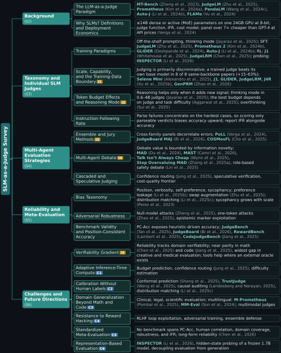
</p>

<p align="center"><sub><b>Figure 1.</b> Taxonomy of the survey. The five dimensions map to §2–§6, with insights I1–I5 and challenges C1–C6 at their primary locations. Each leaf lists representative papers and key concepts.</sub></p>

| § | Section | What it covers |
|:--:|:--|:--|
| 2 | Background | The LLM-as-a-Judge paradigm, the ≤14B definition and deployment economics |
| 3 | Taxonomy and Individual SLM Judges | Training paradigms, scale and the training-data boundary, token budget and reasoning mode, instruction following rate (IFR) |
| 4 | Multi-Agent Evaluation Strategies | Ensemble and jury methods, multi-agent debate, cascaded and speculative judging |
| 5 | Reliability and Meta-Evaluation | Bias taxonomy, adversarial robustness, benchmark validity and position-consistent accuracy |
| 6 | Challenges and Future Directions | The verifiability gradient (I5) and challenges C1–C6 |

The appendices (A–O) extend every branch, covering the SLM landscape, training methods, token budgets, ensembles, debate, biases, benchmarks, domains, robustness, a research agenda, the survey method and per-insight evidence tables.

<a id="five-insights"></a>

## 💡 Five insights

Each insight carries an evidence grade. **Consensus** means a finding replicated across four or more independent sources, **Replicated** means two or three sources (or one study with strong controls), and **Preliminary** means a single study or an untested mechanism. Sources count as independent when they come from different groups and do not share both backbone and benchmark. The table follows Table 2 of the survey.

| Insight | Evidence | Main support | Boundary conditions |
|:--|:--|:--|:--|
| **I1** Evaluation-specific training matters more than scale | **Consensus**: 5 independent lines; across related benchmarks | Selene Mini, J1, GLIDER, JudgeLRM, J4R, GenPRM; the trained judge beats its own base model in 8 of 8 papers (+15–63%) | Smaller margins on fine-grained rubric correlation (FLASK) and on the hardest pairs (JudgeBench) |
| **I2** Reasoning helps only when it adds new signal | **Consensus**: 7 studies; across tasks | Thinking-mode gains in 0.6–4B judges; NoThinking wins at low budgets; accuracy collapses past a complexity threshold | The best budget depends on both the judge and the task difficulty |
| **I3** Cross-family panels decorrelate errors | **Replicated**: 3 studies; QA, math, code | PoLL (over 7× cheaper than GPT-4), JudgeBoard, COSMosFL | Each member must beat chance; members should come from different families |
| **I4** Debate value is bounded by information novelty | **Consensus**: 5 studies; across tasks | Gains when agents hold distinct evidence or assigned roles; MAST failure analysis | Shared-context debate loses to single agents given equal compute |
| **I5** Reliability tracks domain verifiability | **Consensus**: 8 domains; across domains | Near parity in math and code, good agreement in factual QA | Widest gap in creative and medical evaluation |

Across surveyed studies, fine-tuned 3–8B judges match proprietary-model accuracy on standard benchmarks, and heterogeneous panels of smaller models reach comparable quality at over 7× lower API cost under reported protocols. This parity narrows in subjective domains that lack external verification. Position-consistent accuracy protocols also show that much apparent judge performance is heuristic-driven, and that all judges, frontier models included, degrade sharply on hard evaluation pairs.

<table>
  <tr>
    <td width="50%" align="center">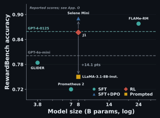<br><sub><b>(a) I1: training vs. scale.</b> Published RewardBench accuracy against model size.</sub></td>
    <td width="50%" align="center">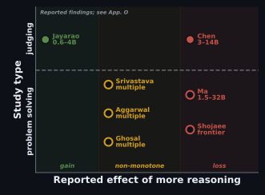<br><sub><b>(b) I2: effect of more reasoning.</b> Reasoning-budget studies by the effect they report.</sub></td>
  </tr>
  <tr>
    <td width="50%" align="center">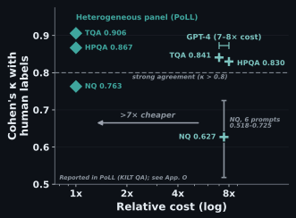<br><sub><b>(c) I3: panel vs. GPT-4.</b> PoLL's agreement with human labels against cost.</sub></td>
    <td width="50%" align="center">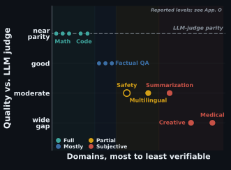<br><sub><b>(d) I5: verifiability gradient.</b> Reported quality by domain, ordered by verifiability.</sub></td>
  </tr>
</table>

<p align="center"><sub><b>Figure 2.</b> The four quantitative trends behind the insights. Panels (a) and (c) plot reported numbers, and panels (b) and (d) place each study by its reported outcome. I4 is discussed in §4.</sub></p>

<a id="six-open-challenges"></a>

## 🧩 Six open challenges

The challenges in §6 follow from the verifiability gradient (I5). Appendix L expands each one into a research direction.

| | Challenge | Why it is open |
|:--:|:--|:--|
| **C1** | Adaptive inference-time compute | The best reasoning budget varies sharply with task difficulty, but confidence-based routing needs calibration that SLM judges lack, since they are overconfident where they are least accurate. |
| **C2** | Calibration without human labels | Conformal prediction, TrustJudge, causal surrogate auditing and fine-tuning 7–9B judges to match preference distributions are starting points, not general frameworks. |
| **C3** | Domain generalization beyond math and code | Only 5% of 650 judge papers address multilingual or low-resource settings. M-Prometheus is a first step, MM-Eval tests judges in 18 languages (122 for language consistency), and multimodal SLM judges remain rare. |
| **C4** | Resistance to reward hacking | Generators trained against an SLM judge produce superficially convincing reasoning, and SLM robustness is less studied than LLM robustness. |
| **C5** | Standardized meta-evaluation | No benchmark spans position-consistent accuracy, human correlation, domain coverage, robustness and IFR, and long-form evaluation is the weakest area. |
| **C6** | Representation-based evaluation | Probing the hidden states of a frozen 1.7B model closely approximates full LLM judges on GSM8K, MATH and GPQA, but open-ended evaluation remains untested. |

<a id="from-insights-to-deployment"></a>

## 🚦 From insights to deployment

<p align="center">
  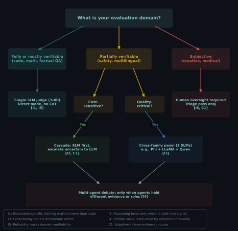
</p>

<p align="center"><sub><b>Figure 14.</b> Deployment flowchart. Domain verifiability (I5) is the routing variable.</sub></p>

Read together, the insights give a simple recipe for choosing a judge (§6 and App. L).

- For verifiable, low-stakes evaluation such as math, code and factual QA, a single fine-tuned 3–8B judge giving a direct verdict is a practical default, paired with a tool wherever an external oracle exists (I1, I5).
- When a domain is only partly verifiable, the budget decides the design. A cascade that escalates uncertain cases to a larger judge keeps spending low (I2, C1), and a panel of three judges from different families buys reliability when quality matters most (I3).
- Hard comparisons can go to thinking mode, which lifts the Chat Hard accuracy of 1.7B and 4B judges by about 30% (I2).
- Debate earns its cost only when the agents hold different evidence or roles (I4).
- Subjective, high-stakes evaluation keeps a human in the loop.

Whatever the design, report position-consistent accuracy, which exposes positional heuristics, and IFR, which exposes silent parse failures, next to accuracy.

<a id="paper-list"></a>

## 📚 Paper list

The list holds every work the survey cites, sorted into the five categories of the survey's corpus statistics (App. M). The sub-headings follow the survey's sections and tables, and the newest works come first in each table. Venue and year are given as in the survey's bibliography. The line under each title names the first author and the parts of the survey that cite the work.

<!-- BEGIN GENERATED: corpus -->
| Category | Works | 2023 or earlier | 2024 | 2025 | 2026 |
|:--|:--:|:--:|:--:|:--:|:--:|
| ⚖️ [Judge systems](#judge-systems) | **29** | 1 | 8 | 14 | 6 |
| 📊 [Benchmarks and metrics](#benchmarks-metrics) | **20** | 9 | 3 | 6 | 2 |
| 🛠️ [Training and methodology](#training-methodology) | **26** | 7 | 5 | 11 | 3 |
| 🛡️ [Bias and robustness](#bias-robustness) | **13** | 2 | 3 | 7 | 1 |
| 🧱 [Foundational and model reports](#foundational-models) | **17** | 2 | 7 | 6 | 2 |
| **All works** | **105** | **21** | **26** | **44** | **14** |
<!-- END GENERATED: corpus -->


<!-- BEGIN GENERATED: papers -->
<a id="judge-systems"></a>

### ⚖️ Judge systems <sub>29 works</sub>

Models and pipelines that act as judges, from prompted small models to trained, probed and multi-model judges. <sub>Survey: §3, §4, Table 9, App. C</sub>

<details>
<summary>Figure 5. Judge training paradigms by training cost and bias-mitigation strength (App. C)</summary>
<br>
<p align="center">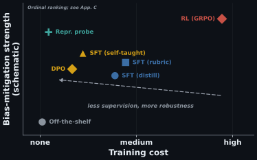</p>
</details>

#### Prompted judges and judges in applications <sub>(2)</sub>

| Paper | Venue | Year | Links |
|:--|:--:|:--:|:--|
| **[Explicit Reasoning Makes Better Judges: A Systematic Study on Accuracy, Efficiency, and Robustness](https://arxiv.org/abs/2509.13332)**<br><sub><b>Qwen3-Judge</b> · Jayarao et al. · survey: §3; Apps. B, C, D, H, L, N, O</sub> | arXiv | 2025 | – |
| **[Crowd Comparative Reasoning: Unlocking Comprehensive Evaluations for LLM-as-a-Judge](https://aclanthology.org/2025.acl-long.252/)**<br><sub>Zhang et al. · survey: App. D</sub> | ACL | 2025 | [arXiv](https://arxiv.org/abs/2502.12501) · [Code](https://github.com/Don-Joey/CCE) · <a href="https://github.com/Don-Joey/CCE"></a> |

#### Supervised fine-tuned judges <sub>(11)</sub>

| Paper | Venue | Year | Links |
|:--|:--:|:--:|:--|
| **[Improving Code Generation via Small Language Model-as-a-judge](https://arxiv.org/abs/2602.11911)**<br><sub>Crupi et al. · survey: App. J</sub> | arXiv | 2026 | – |
| **[Atla Selene Mini: A General Purpose Evaluation Model](https://arxiv.org/abs/2501.17195)**<br><sub>Alexandru et al. · survey: §3; Apps. C, D, O</sub> | arXiv | 2025 | [Code](https://github.com/atla-ai/selene-mini) · <a href="https://github.com/atla-ai/selene-mini"></a> |
| **[M-Prometheus: A Suite of Open Multilingual LLM Judges](https://arxiv.org/abs/2504.04953)**<br><sub>Pombal et al. · survey: §6; Apps. C, I, J, L, O</sub> | arXiv | 2025 | [Model](https://huggingface.co/Unbabel/M-Prometheus-7B) |
| **[JudgeLM: Fine-tuned Large Language Models are Scalable Judges](https://openreview.net/forum?id=xsELpEPn4A)**<br><sub>Zhu et al. · survey: §1, §3, §5; Apps. A, C, O</sub> | ICLR | 2025 | [arXiv](https://arxiv.org/abs/2310.17631) · [Code](https://github.com/baaivision/JudgeLM) · <a href="https://github.com/baaivision/JudgeLM"></a> |
| **[GLIDER: Grading LLM Interactions and Decisions using Explainable Ranking](https://arxiv.org/abs/2412.14140)**<br><sub>Deshpande et al. · survey: §1, §3; Apps. A, B, C, D, O</sub> | arXiv | 2024 | [Model](https://huggingface.co/PatronusAI/glider) |
| **[Prometheus 2: An Open Source Language Model Specialized in Evaluating Other Language Models](https://aclanthology.org/2024.emnlp-main.248/)**<br><sub>Kim et al. · survey: §3; Apps. A, C, H, O</sub> | EMNLP | 2024 | [arXiv](https://arxiv.org/abs/2405.01535) · [Code](https://github.com/prometheus-eval/prometheus-eval) · <a href="https://github.com/prometheus-eval/prometheus-eval"></a> |
| **[Prometheus: Inducing Fine-grained Evaluation Capability in Language Models](https://openreview.net/forum?id=8euJaTveKw)**<br><sub>Kim et al. · survey: §1; Apps. A, C</sub> | ICLR | 2024 | [arXiv](https://arxiv.org/abs/2310.08491) · [Code](https://github.com/prometheus-eval/prometheus) · <a href="https://github.com/prometheus-eval/prometheus"></a> |
| **[Generative Judge for Evaluating Alignment](https://openreview.net/forum?id=gtkFw6sZGS)**<br><sub><b>Auto-J</b> · Li et al. · survey: §3; Apps. A, C</sub> | ICLR | 2024 | [arXiv](https://arxiv.org/abs/2310.05470) · [Code](https://github.com/GAIR-NLP/auto-j) · <a href="https://github.com/GAIR-NLP/auto-j"></a> |
| **[Foundational Autoraters: Taming Large Language Models for Better Automatic Evaluation](https://aclanthology.org/2024.emnlp-main.949/)**<br><sub><b>FLAMe</b> · Vu et al. · survey: Apps. A, C, O</sub> | EMNLP | 2024 | [arXiv](https://arxiv.org/abs/2407.10817) |
| **[PandaLM: An Automatic Evaluation Benchmark for LLM Instruction Tuning Optimization](https://openreview.net/forum?id=5Nn2BLV7SB)**<br><sub>Wang et al. · survey: Apps. A, C</sub> | ICLR | 2024 | [arXiv](https://arxiv.org/abs/2306.05087) · [Code](https://github.com/WeOpenML/PandaLM) · <a href="https://github.com/WeOpenML/PandaLM"></a> |
| **[Shepherd: A Critic for Language Model Generation](https://arxiv.org/abs/2308.04592)**<br><sub>Wang et al. · survey: App. A</sub> | arXiv | 2023 | [Code](https://github.com/facebookresearch/Shepherd) · <a href="https://github.com/facebookresearch/Shepherd"></a> |

#### Self-taught and preference-calibrated judges <sub>(2)</sub>

| Paper | Venue | Year | Links |
|:--|:--:|:--:|:--|
| **[Judging with Confidence: Calibrating Autoraters to Preference Distributions](https://arxiv.org/abs/2510.00263)**<br><sub>Li et al. · survey: §5, §6; Apps. H, L</sub> | arXiv | 2025 | – |
| **[Self-Taught Evaluators](https://arxiv.org/abs/2408.02666)**<br><sub>Wang et al. · survey: Apps. A, C</sub> | arXiv | 2024 | [Code](https://github.com/facebookresearch/RAM/tree/main/projects/self_taught_evaluator) · <a href="https://github.com/facebookresearch/RAM"></a> |

#### Judges trained with reinforcement learning <sub>(7)</sub>

| Paper | Venue | Year | Links |
|:--|:--:|:--:|:--|
| **[Incentivizing Agentic Reasoning in LLM Judges via Tool-Integrated Reinforcement Learning](https://openreview.net/forum?id=AXNRILww9c)**<br><sub><b>TIR-Judge</b> · Xu et al. · survey: Apps. C, I, J, O</sub> | ICLR | 2026 | [arXiv](https://arxiv.org/abs/2510.23038) |
| **[GenPRM: Scaling Test-Time Compute of Process Reward Models via Generative Reasoning](https://arxiv.org/abs/2504.00891)**<br><sub>Zhao et al. · survey: §3; Apps. C, L</sub> | AAAI | 2026 | [Code](https://github.com/RyanLiu112/GenPRM) · <a href="https://github.com/RyanLiu112/GenPRM"></a> |
| **[JudgeLRM: Large Reasoning Models as a Judge](https://arxiv.org/abs/2504.00050)**<br><sub>Chen et al. · survey: §3, §6; Apps. A, C, D, N, O</sub> | arXiv | 2025 | [Code](https://github.com/NuoJohnChen/JudgeLRM) · <a href="https://github.com/NuoJohnChen/JudgeLRM"></a> |
| **[J1: Incentivizing Thinking in LLM-as-a-Judge via Reinforcement Learning](https://arxiv.org/abs/2505.10320)**<br><sub>Whitehouse et al. · survey: §1, §3, §5; Apps. A, B, C, D, H, I, K, L, O</sub> | arXiv | 2025 | – |
| **[StepWiser: Stepwise Generative Judges for Wiser Reasoning](https://arxiv.org/abs/2508.19229)**<br><sub>Xiong et al. · survey: Apps. C, L</sub> | arXiv | 2025 | – |
| **[J4R: Learning to Judge with Equivalent Initial State Group Relative Policy Optimization](https://arxiv.org/abs/2505.13346)**<br><sub>Xu et al. · survey: §3; Apps. A, C</sub> | arXiv | 2025 | – |
| **[CompassJudger-2: Towards Generalist Judge Model via Verifiable Rewards](https://arxiv.org/abs/2507.09104)**<br><sub>Zhang et al. · survey: §3; Apps. A, C, I</sub> | arXiv | 2025 | [Code](https://github.com/open-compass/CompassJudger) · <a href="https://github.com/open-compass/CompassJudger"></a> |

#### Representation-based judges <sub>(2)</sub>

| Paper | Venue | Year | Links |
|:--|:--:|:--:|:--|
| **[Beyond the Surface: Enhancing LLM-as-a-Judge Alignment with Human via Internal Representations](https://arxiv.org/abs/2508.03550)**<br><sub><b>LAGER</b> · Lai et al. · survey: App. C</sub> | NeurIPS | 2026 | – |
| **[Rethinking LLM-as-a-Judge: Representation-as-a-Judge with Small Language Models via Semantic Capacity Asymmetry](https://arxiv.org/abs/2601.22588)**<br><sub><b>INSPECTOR</b> · Li et al. · survey: §3, §6; Apps. A, C, D, L</sub> | arXiv | 2026 | [Code](https://github.com/zhuochunli/Representation-as-a-judge) · <a href="https://github.com/zhuochunli/Representation-as-a-judge"></a> |

#### Panels, cascades and debate judges <sub>(5)</sub>

| Paper | Venue | Year | Links |
|:--|:--:|:--:|:--|
| **[Multi-Agent Debate for LLM Judges with Adaptive Stability Detection](https://arxiv.org/abs/2510.12697)**<br><sub>Hu et al. · survey: App. G</sub> | NeurIPS | 2026 | – |
| **[COSMosFL: Ensemble of Small Language Models for Fault Localisation](https://arxiv.org/abs/2502.02908)**<br><sub>Cho et al. · survey: §4; Apps. E, N</sub> | LLM4Code | 2025 | [Code](https://github.com/coinse/cosmosfl) · <a href="https://github.com/coinse/cosmosfl"></a> |
| **[Trust or Escalate: LLM Judges with Provable Guarantees for Human Agreement](https://openreview.net/forum?id=UHPnqSTBPO)**<br><sub>Jung et al. · survey: §4, §6; Apps. H, L</sub> | ICLR | 2025 | [arXiv](https://arxiv.org/abs/2407.18370) · [Code](https://github.com/jaehunjung1/cascaded-selective-evaluation) · <a href="https://github.com/jaehunjung1/cascaded-selective-evaluation"></a> |
| **[Efficient LLM Safety Evaluation through Multi-Agent Debate](https://arxiv.org/abs/2511.06396)**<br><sub>Lin et al. · survey: §4; Apps. G, J, N</sub> | arXiv | 2025 | – |
| **[Replacing Judges with Juries: Evaluating LLM Generations with a Panel of Diverse Models](https://arxiv.org/abs/2404.18796)**<br><sub><b>PoLL</b> · Verga et al. · survey: §2, §4; Apps. A, E, H, K, N, O</sub> | arXiv | 2024 | – |

<p align="right"><a href="#contents">back to contents ↑</a></p>

<a id="benchmarks-metrics"></a>

### 📊 Benchmarks and metrics <sub>20 works</sub>

Benchmarks that test judges and reward models, task benchmarks used in judge studies, and text evaluation metrics. <sub>Survey: §5.3, Table 24, App. I, App. J</sub>

<details>
<summary>Figure 11. Meta-evaluation dimensions covered by the major judge benchmarks (App. I)</summary>
<br>
<p align="center">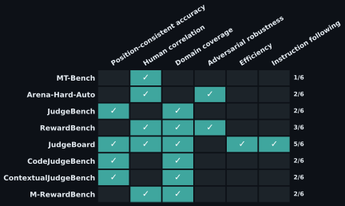</p>
</details>

#### Judge and reward-model benchmarks <sub>(8)</sub>

| Paper | Venue | Year | Links |
|:--|:--:|:--:|:--|
| **[JudgeBoard: Benchmarking and Enhancing Small Language Models for Reasoning Evaluation](https://arxiv.org/abs/2511.15958)**<br><sub>Bi et al. · survey: §1, §4, §5, §6; Apps. E, I, N, O</sub> | AAAI | 2026 | – |
| **[Benchmarking LLM-as-a-Judge for Long-Form Output Evaluation](https://arxiv.org/abs/2606.01629)**<br><sub>Chen et al. · survey: §6; App. L</sub> | arXiv | 2026 | [Code](https://github.com/cjj826/LongJudgeBench) · <a href="https://github.com/cjj826/LongJudgeBench"></a> |
| **[CodeJudgeBench: Benchmarking LLM-as-a-Judge for Coding Tasks](https://arxiv.org/abs/2507.10535)**<br><sub>Jiang et al. · survey: §3, §5, §6; Apps. I, J, O</sub> | arXiv | 2025 | [Code](https://github.com/hongcha0/CodeJudgeBench) · <a href="https://github.com/hongcha0/CodeJudgeBench"></a> |
| **[RewardBench: Evaluating Reward Models for Language Modeling](https://aclanthology.org/2025.findings-naacl.96/)**<br><sub>Lambert et al. · survey: Apps. C, I, M</sub> | Findings of NAACL | 2025 | [arXiv](https://arxiv.org/abs/2403.13787) · [Code](https://github.com/allenai/reward-bench) · <a href="https://github.com/allenai/reward-bench"></a> |
| **[JudgeBench: A Benchmark for Evaluating LLM-based Judges](https://openreview.net/forum?id=G0dksFayVq)**<br><sub>Tan et al. · survey: §1, §3, §5; Apps. C, H, I</sub> | ICLR | 2025 | [arXiv](https://arxiv.org/abs/2410.12784) · [Code](https://github.com/ScalerLab/JudgeBench) · <a href="https://github.com/ScalerLab/JudgeBench"></a> |
| **[Does Context Matter? ContextualJudgeBench for Evaluating LLM-based Judges in Contextual Settings](https://aclanthology.org/2025.acl-long.470/)**<br><sub>Xu et al. · survey: App. I</sub> | ACL | 2025 | [arXiv](https://arxiv.org/abs/2503.15620) · [Code](https://github.com/SalesforceAIResearch/ContextualJudgeBench) · <a href="https://github.com/SalesforceAIResearch/ContextualJudgeBench"></a> |
| **[MM-Eval: A Multilingual Meta-Evaluation Benchmark for LLM-as-a-Judge and Reward Models](https://arxiv.org/abs/2410.17578)**<br><sub>Son et al. · survey: §6; App. J</sub> | arXiv | 2024 | [Code](https://github.com/guijinSON/MM-Eval) · <a href="https://github.com/guijinSON/MM-Eval"></a> |
| **[Judging LLM-as-a-Judge with MT-Bench and Chatbot Arena](https://arxiv.org/abs/2306.05685)**<br><sub>Zheng et al. · survey: §1, §2, §5; Apps. A, H, I</sub> | NeurIPS | 2023 | [Code](https://github.com/lm-sys/FastChat/tree/main/fastchat/llm_judge) · <a href="https://github.com/lm-sys/FastChat"></a> |

#### Task benchmarks used in judge studies <sub>(8)</sub>

| Paper | Venue | Year | Links |
|:--|:--:|:--:|:--|
| **[OptimalThinkingBench: Evaluating Over and Underthinking in LLMs](https://arxiv.org/abs/2508.13141)**<br><sub>Aggarwal et al. · survey: §3; Apps. D, N, O</sub> | arXiv | 2025 | [Code](https://github.com/facebookresearch/RAM/tree/main/projects/otb) · <a href="https://github.com/facebookresearch/RAM"></a> |
| **[LiveCodeBench: Holistic and Contamination Free Evaluation of Large Language Models for Code](https://openreview.net/forum?id=chfJJYC3iL)**<br><sub>Jain et al. · survey: App. J</sub> | ICLR | 2025 | [arXiv](https://arxiv.org/abs/2403.07974) · [Code](https://github.com/LiveCodeBench/LiveCodeBench) · <a href="https://github.com/LiveCodeBench/LiveCodeBench"></a> |
| **[SWE-bench: Can Language Models Resolve Real-World GitHub Issues?](https://openreview.net/forum?id=VTF8yNQM66)**<br><sub>Jimenez et al. · survey: App. J</sub> | ICLR | 2024 | [arXiv](https://arxiv.org/abs/2310.06770) · [Code](https://github.com/SWE-bench/SWE-bench) · <a href="https://github.com/SWE-bench/SWE-bench"></a> |
| **[DecodingTrust: A Comprehensive Assessment of Trustworthiness in GPT Models](https://arxiv.org/abs/2306.11698)**<br><sub>Wang et al. · survey: Apps. J, O</sub> | NeurIPS | 2023 | [Code](https://github.com/AI-secure/DecodingTrust) · <a href="https://github.com/AI-secure/DecodingTrust"></a> |
| **[TruthfulQA: Measuring How Models Mimic Human Falsehoods](https://aclanthology.org/2022.acl-long.229/)**<br><sub>Lin et al. · survey: Apps. J, O</sub> | ACL | 2022 | [arXiv](https://arxiv.org/abs/2109.07958) · [Code](https://github.com/sylinrl/TruthfulQA) · <a href="https://github.com/sylinrl/TruthfulQA"></a> |
| **[Training Verifiers to Solve Math Word Problems](https://arxiv.org/abs/2110.14168)**<br><sub><b>GSM8K</b> · Cobbe et al. · survey: Apps. C, L</sub> | arXiv | 2021 | [Code](https://github.com/openai/grade-school-math) · <a href="https://github.com/openai/grade-school-math"></a> |
| **[Measuring Mathematical Problem Solving With the MATH Dataset](https://arxiv.org/abs/2103.03874)**<br><sub>Hendrycks et al. · survey: Apps. C, I, L</sub> | arXiv | 2021 | [Code](https://github.com/hendrycks/math) · <a href="https://github.com/hendrycks/math"></a> |
| **[Measuring Massive Multitask Language Understanding](https://arxiv.org/abs/2009.03300)**<br><sub><b>MMLU</b> · Hendrycks et al. · survey: App. I</sub> | arXiv | 2020 | [Code](https://github.com/hendrycks/test) · <a href="https://github.com/hendrycks/test"></a> |

#### Text evaluation metrics <sub>(4)</sub>

| Paper | Venue | Year | Links |
|:--|:--:|:--:|:--|
| **[FLEUR: An Explainable Reference-Free Evaluation Metric for Image Captioning Using a Large Multimodal Model](https://aclanthology.org/2024.acl-long.205/)**<br><sub>Lee et al. · survey: §6; Apps. B, H, J</sub> | ACL | 2024 | [arXiv](https://arxiv.org/abs/2406.06004) · [Code](https://github.com/Yebin46/FLEUR) · <a href="https://github.com/Yebin46/FLEUR"></a> |
| **[COMET: A Neural Framework for MT Evaluation](https://aclanthology.org/2020.emnlp-main.213/)**<br><sub>Rei et al. · survey: App. A</sub> | EMNLP | 2020 | [arXiv](https://arxiv.org/abs/2009.09025) · [Code](https://github.com/Unbabel/COMET) · <a href="https://github.com/Unbabel/COMET"></a> |
| **[BERTScore: Evaluating Text Generation with BERT](https://arxiv.org/abs/1904.09675)**<br><sub>Zhang et al. · survey: App. A</sub> | arXiv | 2019 | [Code](https://github.com/Tiiiger/bert_score) · <a href="https://github.com/Tiiiger/bert_score"></a> |
| **[BLEU: a Method for Automatic Evaluation of Machine Translation](https://aclanthology.org/P02-1040/)**<br><sub>Papineni et al. · survey: App. A</sub> | ACL | 2002 | – |

<p align="right"><a href="#contents">back to contents ↑</a></p>

<a id="training-methodology"></a>

### 🛠️ Training and methodology <sub>26 works</sub>

Methods that judges are built on or run with, such as preference training, reasoning budgets, debate and calibration. <sub>Survey: §3.3, §4.2, §6, App. C, App. D, App. G, App. L</sub>

<details>
<summary>Figure 6. The decreasing-supervision gradient from distillation to probing (App. C)</summary>
<br>
<p align="center">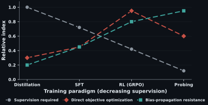</p>
</details>

#### Alignment and reward modeling <sub>(6)</sub>

| Paper | Venue | Year | Links |
|:--|:--:|:--:|:--|
| **[Igniting Creative Writing in Small Language Models: LLM-as-a-Judge versus Multi-Agent Refined Rewards](https://aclanthology.org/2025.emnlp-main.868/)**<br><sub>Wei et al. · survey: §6; Apps. J, N, O</sub> | EMNLP | 2025 | [arXiv](https://arxiv.org/abs/2508.21476) · [Code](https://github.com/weixiaolong94-hub/Igniting-Creative-Writing-in-Small-Language-Models) · <a href="https://github.com/weixiaolong94-hub/Igniting-Creative-Writing-in-Small-Language-Models"></a> |
| **[Let's Verify Step by Step](https://openreview.net/forum?id=v8L0pN6EOi)**<br><sub>Lightman et al. · survey: Apps. C, J, L</sub> | ICLR | 2024 | [arXiv](https://arxiv.org/abs/2305.20050) · [Code](https://github.com/openai/prm800k) · <a href="https://github.com/openai/prm800k"></a> |
| **[Weak-to-Strong Generalization: Eliciting Strong Capabilities With Weak Supervision](https://arxiv.org/abs/2312.09390)**<br><sub>Burns et al. · survey: Apps. A, L</sub> | arXiv | 2023 | [Code](https://github.com/openai/weak-to-strong) · <a href="https://github.com/openai/weak-to-strong"></a> |
| **[Direct Preference Optimization: Your Language Model is Secretly a Reward Model](https://arxiv.org/abs/2305.18290)**<br><sub><b>DPO</b> · Rafailov et al. · survey: App. C</sub> | NeurIPS | 2023 | [Code](https://github.com/eric-mitchell/direct-preference-optimization) · <a href="https://github.com/eric-mitchell/direct-preference-optimization"></a> |
| **[Constitutional AI: Harmlessness from AI Feedback](https://arxiv.org/abs/2212.08073)**<br><sub>Bai et al. · survey: §1; Apps. A, J</sub> | arXiv | 2022 | [Code](https://github.com/anthropics/ConstitutionalHarmlessnessPaper) · <a href="https://github.com/anthropics/ConstitutionalHarmlessnessPaper"></a> |
| **[Training language models to follow instructions with human feedback](https://arxiv.org/abs/2203.02155)**<br><sub><b>InstructGPT</b> · Ouyang et al. · survey: §1; App. A</sub> | NeurIPS | 2022 | [Code](https://github.com/openai/following-instructions-human-feedback) · <a href="https://github.com/openai/following-instructions-human-feedback"></a> |

#### Reasoning budget and inference <sub>(10)</sub>

| Paper | Venue | Year | Links |
|:--|:--:|:--:|:--|
| **[Does Thinking More always Help? Mirage of Test-Time Scaling in Reasoning Models](https://arxiv.org/abs/2506.04210)**<br><sub>Ghosal et al. · survey: Apps. D, N, O</sub> | NeurIPS | 2026 | – |
| **[The Illusion of Thinking: Understanding the Strengths and Limitations of Reasoning Models via the Lens of Problem Complexity](https://arxiv.org/abs/2506.06941)**<br><sub>Shojaee et al. · survey: §3; Apps. D, N, O</sub> | NeurIPS | 2026 | – |
| **[Token-Budget-Aware LLM Reasoning](https://aclanthology.org/2025.findings-acl.1274/)**<br><sub>Han et al. · survey: §3; App. D</sub> | Findings of ACL | 2025 | [arXiv](https://arxiv.org/abs/2412.18547) |
| **[Reasoning Models Can Be Effective Without Thinking](https://arxiv.org/abs/2504.09858)**<br><sub><b>NoThinking</b> · Ma et al. · survey: Apps. D, N, O</sub> | arXiv | 2025 | – |
| **[Do LLMs Overthink Basic Math Reasoning? Benchmarking the Accuracy-Efficiency Tradeoff in Language Models](https://arxiv.org/abs/2507.04023)**<br><sub>Srivastava et al. · survey: Apps. D, N, O</sub> | arXiv | 2025 | [Code](https://github.com/ctrl-gaurav/LLMThinkBench) · <a href="https://github.com/ctrl-gaurav/LLMThinkBench"></a> |
| **[Stop Overthinking: A Survey on Efficient Reasoning for Large Language Models](https://arxiv.org/abs/2503.16419)**<br><sub>Sui et al. · survey: §3; App. D</sub> | arXiv | 2025 | [Code](https://github.com/Eclipsess/Awesome-Efficient-Reasoning-LLMs) · <a href="https://github.com/Eclipsess/Awesome-Efficient-Reasoning-LLMs"></a> |
| **[Reasoning in Token Economies: Budget-Aware Evaluation of LLM Reasoning Strategies](https://aclanthology.org/2024.emnlp-main.1112/)**<br><sub>Wang et al. · survey: App. D</sub> | EMNLP | 2024 | [arXiv](https://arxiv.org/abs/2406.06461) |
| **[Efficient Memory Management for Large Language Model Serving with PagedAttention](https://arxiv.org/abs/2309.06180)**<br><sub><b>vLLM</b> · Kwon et al. · survey: App. B</sub> | SOSP | 2023 | [Code](https://github.com/vllm-project/vllm) · <a href="https://github.com/vllm-project/vllm"></a> |
| **[Self-Consistency Improves Chain of Thought Reasoning in Language Models](https://arxiv.org/abs/2203.11171)**<br><sub>Wang et al. · survey: Apps. D, E, N</sub> | arXiv | 2022 | – |
| **[Chain-of-Thought Prompting Elicits Reasoning in Large Language Models](https://arxiv.org/abs/2201.11903)**<br><sub>Wei et al. · survey: §3</sub> | NeurIPS | 2022 | – |

#### Multi-agent debate <sub>(6)</sub>

| Paper | Venue | Year | Links |
|:--|:--:|:--:|:--|
| **[Why Do Multi-Agent LLM Systems Fail?](https://arxiv.org/abs/2503.13657)**<br><sub><b>MAST</b> · Cemri et al. · survey: §4; Apps. G, N</sub> | NeurIPS | 2026 | [Code](https://github.com/multi-agent-systems-failure-taxonomy/MAST) · <a href="https://github.com/multi-agent-systems-failure-taxonomy/MAST"></a> |
| **[DEBATE, TRAIN, EVOLVE: Self Evolution of Language Model Reasoning](https://aclanthology.org/2025.emnlp-main.1666/)**<br><sub>Srivastava et al. · survey: App. G</sub> | EMNLP | 2025 | [arXiv](https://arxiv.org/abs/2505.15734) · [Code](https://github.com/ctrl-gaurav/Debate-Train-Evolve) · <a href="https://github.com/ctrl-gaurav/Debate-Train-Evolve"></a> |
| **[Talk Isn't Always Cheap: Understanding Failure Modes in Multi-Agent Debate](https://arxiv.org/abs/2509.05396)**<br><sub>Wynn et al. · survey: §1, §4; Apps. G, N</sub> | arXiv | 2025 | – |
| **[Stop Overvaluing Multi-Agent Debate -- We Must Rethink Evaluation and Embrace Model Heterogeneity](https://arxiv.org/abs/2502.08788)**<br><sub>Zhang et al. · survey: §1, §4; Apps. G, N</sub> | arXiv | 2025 | – |
| **[Improving Factuality and Reasoning in Language Models through Multiagent Debate](https://arxiv.org/abs/2305.14325)**<br><sub>Du et al. · survey: §4; Apps. G, N</sub> | ICML | 2024 | [Code](https://github.com/composable-models/llm_multiagent_debate) · <a href="https://github.com/composable-models/llm_multiagent_debate"></a> |
| **[Encouraging Divergent Thinking in Large Language Models through Multi-Agent Debate](https://aclanthology.org/2024.emnlp-main.992/)**<br><sub>Liang et al. · survey: §4; Apps. G, N</sub> | EMNLP | 2024 | [arXiv](https://arxiv.org/abs/2305.19118) · [Code](https://github.com/Skytliang/Multi-Agents-Debate) · <a href="https://github.com/Skytliang/Multi-Agents-Debate"></a> |

#### Calibration and agreement with humans <sub>(4)</sub>

| Paper | Venue | Year | Links |
|:--|:--:|:--:|:--|
| **[Causal Judge Evaluation: Calibrated Surrogate Metrics for LLM Systems](https://arxiv.org/abs/2512.11150)**<br><sub><b>CJE</b> · Landesberg and Narayan · survey: §6; App. L</sub> | arXiv | 2025 | [Code](https://github.com/cimo-labs/cje) · <a href="https://github.com/cimo-labs/cje"></a> |
| **[Analyzing Uncertainty of LLM-as-a-Judge: Interval Evaluations with Conformal Prediction](https://aclanthology.org/2025.emnlp-main.569/)**<br><sub>Sheng et al. · survey: §6; App. L</sub> | EMNLP | 2025 | [arXiv](https://arxiv.org/abs/2509.18658) · [Code](https://github.com/BruceSheng1202/Analyzing_Uncertainty_of_LLM-as-a-Judge) · <a href="https://github.com/BruceSheng1202/Analyzing_Uncertainty_of_LLM-as-a-Judge"></a> |
| **[TrustJudge: Inconsistencies of LLM-as-a-Judge and How to Alleviate Them](https://arxiv.org/abs/2509.21117)**<br><sub>Wang et al. · survey: §6; Apps. H, L</sub> | arXiv | 2025 | [Code](https://github.com/TrustJudge/TrustJudge) · <a href="https://github.com/TrustJudge/TrustJudge"></a> |
| **[Who Validates the Validators? Aligning LLM-Assisted Evaluation of LLM Outputs with Human Preferences](https://arxiv.org/abs/2404.12272)**<br><sub>Shankar et al. · survey: §1, §5; App. I</sub> | UIST | 2024 | – |

<p align="right"><a href="#contents">back to contents ↑</a></p>

<a id="bias-robustness"></a>

### 🛡️ Bias and robustness <sub>13 works</sub>

Biases of model judges, attacks on them, and how personas change their verdicts. <sub>Survey: §5, App. H, App. K</sub>

<details>
<summary>Figure 10. Relative bias severity for SLM (≤14B) and large LLM (>70B) judges (App. H)</summary>
<br>
<p align="center">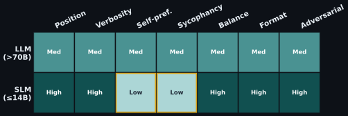70B) judges (App. H)"></p>
</details>

#### Judge biases and validity <sub>(7)</sub>

| Paper | Venue | Year | Links |
|:--|:--:|:--:|:--|
| **[Potential and Perils of Large Language Models as Judges of Unstructured Textual Data](https://arxiv.org/abs/2501.08167)**<br><sub>Bedemariam et al. · survey: §5; App. I</sub> | arXiv | 2025 | – |
| **[Preference Leakage: A Contamination Problem in LLM-as-a-judge](https://arxiv.org/abs/2502.01534)**<br><sub>Li et al. · survey: §5; Apps. C, H</sub> | DIG-BUG Workshop | 2025 | [Code](https://github.com/David-Li0406/Preference-Leakage) · <a href="https://github.com/David-Li0406/Preference-Leakage"></a> |
| **[Limitations of the LLM-as-a-Judge Approach for Evaluating LLM Outputs in Expert Knowledge Tasks](https://arxiv.org/abs/2410.20266)**<br><sub>Szymanski et al. · survey: §5</sub> | IUI | 2025 | – |
| **[Justice or Prejudice? Quantifying Biases in LLM-as-a-Judge](https://openreview.net/forum?id=3GTtZFiajM)**<br><sub><b>CALM</b> · Ye et al. · survey: App. H</sub> | ICLR | 2025 | [arXiv](https://arxiv.org/abs/2410.02736) · [Code](https://github.com/Y0oMu/LLM-Judge-Bias-Dataset) · <a href="https://github.com/Y0oMu/LLM-Judge-Bias-Dataset"></a> |
| **[Humans or LLMs as the Judge? A Study on Judgement Bias](https://aclanthology.org/2024.emnlp-main.474/)**<br><sub>Chen et al. · survey: §5</sub> | EMNLP | 2024 | [arXiv](https://arxiv.org/abs/2402.10669) · [Code](https://github.com/FreedomIntelligence/Humans_LLMs_Judgement_Bias) · <a href="https://github.com/FreedomIntelligence/Humans_LLMs_Judgement_Bias"></a> |
| **[Simple synthetic data reduces sycophancy in large language models](https://arxiv.org/abs/2308.03958)**<br><sub>Wei et al. · survey: §5; Apps. G, H</sub> | arXiv | 2024 | [Code](https://github.com/google/sycophancy-intervention) · <a href="https://github.com/google/sycophancy-intervention"></a> |
| **[Discovering Language Model Behaviors with Model-Written Evaluations](https://aclanthology.org/2023.findings-acl.847/)**<br><sub>Perez et al. · survey: §5; Apps. G, H</sub> | Findings of ACL | 2023 | [arXiv](https://arxiv.org/abs/2212.09251) · [Code](https://github.com/anthropics/evals) · <a href="https://github.com/anthropics/evals"></a> |

#### Adversarial robustness and persona effects <sub>(6)</sub>

| Paper | Venue | Year | Links |
|:--|:--:|:--:|:--|
| **[The Persona Paradox: Medical Personas as Behavioral Priors in Clinical Language Models](https://arxiv.org/abs/2601.05376)**<br><sub>Abdullahi et al. · survey: App. K</sub> | arXiv | 2026 | [Code](https://github.com/rsinghlab/Persona_Paradox) · <a href="https://github.com/rsinghlab/Persona_Paradox"></a> |
| **[SynthesizeMe! Inducing Persona-Guided Prompts for Personalized Reward Models in LLMs](https://aclanthology.org/2025.acl-long.397/)**<br><sub>Ryan et al. · survey: App. K</sub> | ACL | 2025 | [arXiv](https://arxiv.org/abs/2506.05598) · [Code](https://github.com/SALT-NLP/SynthesizeMe) · <a href="https://github.com/SALT-NLP/SynthesizeMe"></a> |
| **[One Token to Fool LLM-as-a-Judge](https://arxiv.org/abs/2507.08794)**<br><sub>Zhao et al. · survey: §5; App. K</sub> | arXiv | 2025 | [Model](https://huggingface.co/sarosavo/Master-RM) |
| **[Cheating Automatic LLM Benchmarks: Null Models Achieve High Win Rates](https://openreview.net/forum?id=syThiTmWWm)**<br><sub>Zheng et al. · survey: §5; App. K</sub> | ICLR | 2025 | [arXiv](https://arxiv.org/abs/2410.07137) · [Code](https://github.com/sail-sg/Cheating-LLM-Benchmarks) · <a href="https://github.com/sail-sg/Cheating-LLM-Benchmarks"></a> |
| **[Two Tales of Persona in LLMs: A Survey of Role-Playing and Personalization](https://aclanthology.org/2024.findings-emnlp.969/)**<br><sub>Tseng et al. · survey: App. K</sub> | Findings of EMNLP | 2024 | [arXiv](https://arxiv.org/abs/2406.01171) · [Code](https://github.com/MiuLab/PersonaLLM-Survey) · <a href="https://github.com/MiuLab/PersonaLLM-Survey"></a> |
| **[In-Context Impersonation Reveals Large Language Models' Strengths and Biases](https://arxiv.org/abs/2305.14930)**<br><sub>Salewski et al. · survey: App. K</sub> | NeurIPS | 2023 | [Code](https://github.com/ExplainableML/in-context-impersonation) · <a href="https://github.com/ExplainableML/in-context-impersonation"></a> |

<p align="right"><a href="#contents">back to contents ↑</a></p>

<a id="foundational-models"></a>

### 🧱 Foundational and model reports <sub>17 works</sub>

Related surveys of LLM judges and small language models, and the reports of the model families that SLM judges are built on. <sub>Survey: §1, Table 1, App. B</sub>

<details>
<summary>Figure 4. Relative strengths of the major SLM families across judge-relevant capabilities (App. B)</summary>
<br>
<p align="center">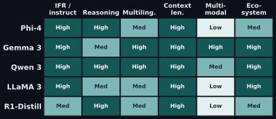</p>
</details>

#### Related surveys <sub>(6)</sub>

| Paper | Venue | Year | Links |
|:--|:--:|:--:|:--|
| **[Challenges and Recommendations for LLMs-as-a-Judge in Multilingual Settings and Low-Resource Languages](https://arxiv.org/abs/2607.02235v1)**<br><sub>Doğruöz et al. · survey: §6; App. L</sub> | arXiv | 2026 | – |
| **[From Generation to Judgment: Opportunities and Challenges of LLM-as-a-judge](https://aclanthology.org/2025.emnlp-main.138/)**<br><sub>Li et al. · survey: §1; Apps. A, M</sub> | EMNLP | 2025 | [arXiv](https://arxiv.org/abs/2411.16594) · [Code](https://github.com/llm-as-a-judge/Awesome-LLM-as-a-judge) · <a href="https://github.com/llm-as-a-judge/Awesome-LLM-as-a-judge"></a> |
| **[A Survey on LLM-as-a-Judge](https://arxiv.org/abs/2411.15594)**<br><sub>Gu et al. · survey: §1; Apps. A, H, M</sub> | The Innovation | 2024 | [Code](https://github.com/DataArcTech/LLM-as-a-Judge) · <a href="https://github.com/DataArcTech/LLM-as-a-Judge"></a> |
| **[LLMs-as-Judges: A Comprehensive Survey on LLM-based Evaluation Methods](https://arxiv.org/abs/2412.05579)**<br><sub>Li et al. · survey: §1; Apps. A, M</sub> | arXiv | 2024 | [Code](https://github.com/CSHaitao/Awesome-LLMs-as-Judges) · <a href="https://github.com/CSHaitao/Awesome-LLMs-as-Judges"></a> |
| **[Small Language Models: Survey, Measurements, and Insights](https://arxiv.org/abs/2409.15790)**<br><sub>Lu et al. · survey: §1, §2; App. A</sub> | arXiv | 2024 | [Code](https://github.com/UbiquitousLearning/SLM_Survey) · <a href="https://github.com/UbiquitousLearning/SLM_Survey"></a> |
| **[Efficient Large Language Models: A Survey](https://arxiv.org/abs/2312.03863)**<br><sub>Wan et al. · survey: §1, §2</sub> | arXiv | 2023 | [Code](https://github.com/AIoT-MLSys-Lab/Efficient-LLMs-Survey) · <a href="https://github.com/AIoT-MLSys-Lab/Efficient-LLMs-Survey"></a> |

#### Model reports <sub>(11)</sub>

| Paper | Venue | Year | Links |
|:--|:--:|:--:|:--|
| **[Gemma 4, Phi-4, and Qwen3: Accuracy-Efficiency Tradeoffs in Dense and MoE Reasoning Language Models](https://arxiv.org/abs/2604.07035v1)**<br><sub>Manik and Wang · survey: App. B</sub> | arXiv | 2026 | – |
| **[Phi-4-reasoning Technical Report](https://arxiv.org/abs/2504.21318)**<br><sub>Abdin et al. · survey: App. B</sub> | arXiv | 2025 | – |
| **[Phi-4-Mini Technical Report: Compact yet Powerful Multimodal Language Models via Mixture-of-LoRAs](https://arxiv.org/abs/2503.01743)**<br><sub>Abouelenin et al. · survey: §1; App. B</sub> | arXiv | 2025 | – |
| **[DeepSeek-R1 incentivizes reasoning in LLMs through reinforcement learning](https://www.nature.com/articles/s41586-025-09422-z)**<br><sub>Guo et al. · survey: §1; Apps. B, C</sub> | Nature | 2025 | [arXiv](https://arxiv.org/abs/2501.12948) · [Code](https://github.com/deepseek-ai/DeepSeek-R1) · <a href="https://github.com/deepseek-ai/DeepSeek-R1"></a> |
| **[Qwen2.5 Technical Report](https://arxiv.org/abs/2412.15115)**<br><sub>Qwen et al. · survey: App. B</sub> | arXiv | 2025 | – |
| **[Qwen3 Technical Report](https://arxiv.org/abs/2505.09388)**<br><sub>Yang et al. · survey: §1; App. B</sub> | arXiv | 2025 | [Code](https://github.com/QwenLM/Qwen3) · <a href="https://github.com/QwenLM/Qwen3"></a> |
| **[Phi-4 Technical Report](https://arxiv.org/abs/2412.08905)**<br><sub>Abdin et al. · survey: §1; App. B</sub> | arXiv | 2024 | – |
| **[Gemma 2: Improving Open Language Models at a Practical Size](https://arxiv.org/abs/2408.00118)**<br><sub>Gemma Team et al. · survey: App. B</sub> | arXiv | 2024 | – |
| **[Gemma: Open Models Based on Gemini Research and Technology](https://arxiv.org/abs/2403.08295)**<br><sub>Gemma Team et al. · survey: App. B</sub> | arXiv | 2024 | – |
| **[The Llama 3 Herd of Models](https://arxiv.org/abs/2407.21783)**<br><sub>Grattafiori et al. · survey: §1; App. B</sub> | arXiv | 2024 | [Code](https://github.com/meta-llama/llama-models) · <a href="https://github.com/meta-llama/llama-models"></a> |
| **[GPT-4 Technical Report](https://arxiv.org/abs/2303.08774)**<br><sub>Achiam et al. · survey: §1</sub> | arXiv | 2023 | – |

<p align="right"><a href="#contents">back to contents ↑</a></p>
<!-- END GENERATED: papers -->

<a id="figures"></a>

## 🖼️ Figures

All 17 figures of the survey are in [`assets/figures`](assets/figures) as dark SVGs.

| Figure | Shows | Survey | In this README |
|:--:|:--|:--:|:--|
| 1 | Taxonomy of the survey | §3 | [Overview](#overview) |
| 2a–2d | The four quantitative trends behind I1, I2, I3 and I5 | §3 | [Five insights](#five-insights) |
| 3 | Distilled reasoning capacity against base size for DeepSeek-R1-Distill on AIME-2024 | App. B | [Below](#more-figures) |
| 4 | Relative strengths of the major SLM families | App. B | [Foundational and model reports](#foundational-models) |
| 5 | Judge training paradigms by training cost and bias-mitigation strength | App. C | [Judge systems](#judge-systems) |
| 6 | The decreasing-supervision gradient of training paradigms | App. C | [Training and methodology](#training-methodology) |
| 7 | Cost-quality frontier of deployment strategies for a single judge | App. D | [Below](#more-figures) |
| 8 | Taxonomy of multi-agent evaluation strategies | App. F | [Below](#more-figures) |
| 9 | Multi-agent system failures across the three MAST categories | App. G | [Below](#more-figures) |
| 10 | Bias severity for SLM and large LLM judges | App. H | [Bias and robustness](#bias-robustness) |
| 11 | Meta-evaluation dimensions covered by judge benchmarks | App. I | [Benchmarks and metrics](#benchmarks-metrics) |
| 12 | Robustness of judge configurations against each attack vector | App. K | [Below](#more-figures) |
| 13 | Coverage gap by model family and benchmark | App. L | [Below](#more-figures) |
| 14 | Deployment flowchart | App. L | [From insights to deployment](#from-insights-to-deployment) |

<a id="more-figures"></a>

<details>
<summary><b>Figure 3.</b> Distilled reasoning capacity scales with base size on AIME-2024 (Pass@1) for the DeepSeek-R1-Distill family (App. B)</summary>
<br>
<p align="center">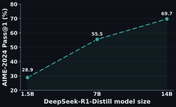</p>
</details>

<details>
<summary><b>Figure 7.</b> Cost-quality frontier for deployment strategies of a single judge (App. D)</summary>
<br>
<p align="center">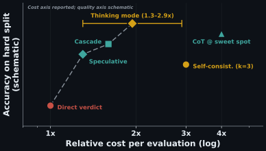</p>
</details>

<details>
<summary><b>Figure 8.</b> Taxonomy of multi-agent evaluation strategies for SLM judges (App. F)</summary>
<br>
<p align="center">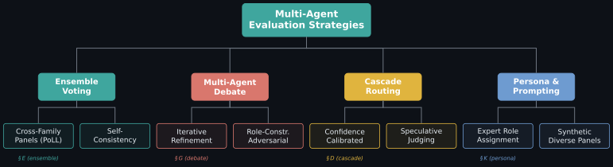</p>
</details>

<details>
<summary><b>Figure 9.</b> Distribution of multi-agent system failures across the three MAST categories (App. G)</summary>
<br>
<p align="center">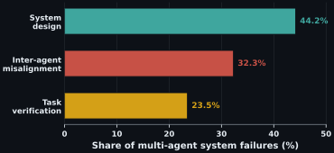</p>
</details>

<details>
<summary><b>Figure 12.</b> Robustness of judge configurations against each attack vector (App. K)</summary>
<br>
<p align="center">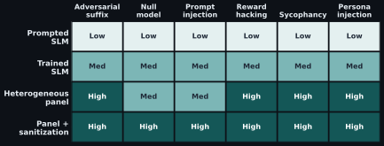</p>
</details>

<details>
<summary><b>Figure 13.</b> Surveyed papers that report SLM judge results for each model family and benchmark (App. L)</summary>
<br>
<p align="center">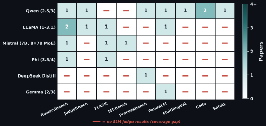</p>
</details>

<a id="citation"></a>

## 📖 Citation

If the survey or this list helps your work, please cite:

```bibtex
@misc{laddha2026slmjudge,
  title  = {Small Language Models as Judges: A Survey},
  author = {Laddha, Anish and Pradhan, Nitesh and Srivastava, Gaurav},
  year   = {2026},
  note   = {Preprint},
  url    = {https://anishh15.github.io/Awesome-SLM-as-a-Judge/}
}
```

The "Cite this repository" button on GitHub gives the same reference from [`CITATION.cff`](CITATION.cff).

<a id="contributing"></a>

## 🤝 Contributing

Found a broken link, a wrong venue or a missing work? Open an [issue](https://github.com/anishh15/Awesome-SLM-as-a-Judge/issues) or a pull request. [CONTRIBUTING.md](CONTRIBUTING.md) explains how to add a paper.

<a id="contact"></a>

## 📬 Contact

- **Email**: [anshladdha15@gmail.com](mailto:anshladdha15@gmail.com), [nitesh.pradhan@lnmiit.ac.in](mailto:nitesh.pradhan@lnmiit.ac.in), [gks@vt.edu](mailto:gks@vt.edu)
- **Issues**: [github.com/anishh15/Awesome-SLM-as-a-Judge/issues](https://github.com/anishh15/Awesome-SLM-as-a-Judge/issues)

## 📄 License

The list, the data file and the scripts are released under the [MIT License](LICENSE). The figures come from the survey, and each listed work belongs to its authors.

<div align="center">
<br>
<a href="#contents"></a>
</div>
